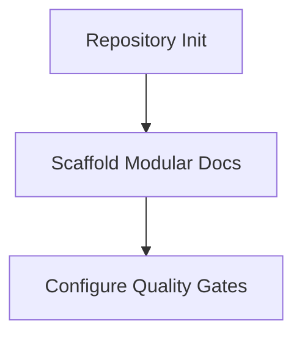

# Phase 0: Initial Architecture & Baseline Setup

> **Status:** 🟢 **COMPLETED**  
> **Created:** 2026-11-21 19:26:16  
> **Last Updated:** 2026-11-21  
> **Target Source Files:** Repository Architecture & Configuration  
> **Prerequisites:** None  

---

## 📋 Phase Objectives & Progress Checklist

- [x] **Objective 1**: Scaffold repository structure and configure tooling
- [x] **Objective 2**: Establish documentation architecture and agent operating rules
- [x] **Objective 3**: Configure mechanical quality gates and verification scripts

---

## 1. Overview & Architectural Goals

Baseline architecture and documentation setup for **Speedy Site SaaS**.

---

## 2. Component Architecture & Data Flows

---

## 3. Implementation Tasks

1. **Step 1: Scaffolding & Types**:
   - Define data transfer objects, types, and schema models.
2. **Step 2: Core Domain Logic**:
   - Implement business logic, service boundaries, and state mutations.
3. **Step 3: Verification & Integration**:
   - Wire endpoints / UI components, add error boundaries, and verify edge cases.

---

## 4. Verification & Validation Checklist

- [x] Quality check passes: `make check`
- [x] TypeScript types compile: `pnpm exec tsc --noEmit`
- [x] Documentation structure audit verified: `audit_docs.py`
