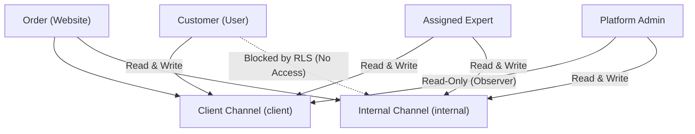
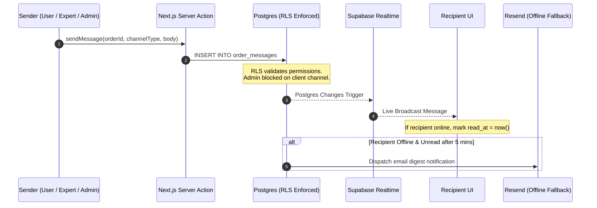

# Plan: Order Communication Channels (Customer-Expert with Admin Oversight)

> **Status:** 🟡 **IN PROGRESS**  
> **Created:** 2026-11-21 20:57:05  
> **Last Updated:** 2026-11-21  
> **Target Source Files:** `supabase/migrations/`, `src/types/database.types.ts`, `src/lib/chat/`, `src/components/chat/`, `src/app/(dashboard)/dashboard/`  
> **Prerequisites:** [2026-11-21_192616_00_initial_architecture_setup.md](file:///home/victor/Projects/Speedy_Site_SaaS/docs/plans/2026-11-21_192616_00_initial_architecture_setup.md)  
> **Related ADR:** [ADR-0002: Order-Scoped Communication Channels with Role-Gated Access](file:///home/victor/Projects/Speedy_Site_SaaS/docs/adr/0002-order-communication-channels.md)  

---

## 📋 Phase Objectives & Progress Checklist

- [ ] **Phase 1: Database Schema & Row Level Security (RLS)**
  - [ ] Migration for `order_conversations` and `order_messages` tables.
  - [ ] Unique constraints on `(order_id, channel_type)` where `channel_type IN ('client', 'internal')`.
  - [ ] Composite index on `order_messages(conversation_id, created_at DESC)`.
  - [ ] Row Level Security policies enforcing client read/write, admin read-only on client channel, and admin-expert internal backchannel.
  - [ ] Regenerate TypeScript definitions (`make types`).
- [ ] **Phase 2: Supabase Realtime Setup & Channel Contracts**
  - [ ] Add `order_messages` to `supabase_realtime` publication.
  - [ ] Implement typed Realtime client listener helper in `src/lib/chat/realtime.ts`.
  - [ ] Wire presence and typing indicator broadcast channels.
- [ ] **Phase 3: Server Actions & Data Access Layer**
  - [ ] Fetch paginated message history (`cursor`, `limit = 50`) with sender profile metadata.
  - [ ] Server action for sending messages with role and assignment validation.
  - [ ] Server action for batch-updating `read_at` timestamps for incoming unread messages.
- [ ] **Phase 4: Notification Pipeline (Email Fallback)**
  - [ ] Debounced unread notification strategy (Resend integration).
  - [ ] Notification preferences check and rate-limiting to prevent recipient inbox spam.
- [ ] **Phase 5: UI Components & Dashboard Integration**
  - [ ] Reusable chat components in `src/components/chat/` (`MessageList`, `MessageBubble`, `ChatInput`, `TypingIndicator`).
  - [ ] Customer Dashboard integration: Customer-expert chat panel inside order details.
  - [ ] Expert Dashboard integration: Dual-view panel (`Customer Chat` and `Internal Admin Notes`).
  - [ ] Admin Dashboard integration: Read-only customer dialogue stream alongside active Admin-to-Expert communication thread.
- [ ] **Phase 6: Quality Verification & Gate Checks**
  - [ ] RLS policy audit: Verify admin cannot insert into `client` channel.
  - [ ] Customer isolation audit: Verify customer cannot read or write to `internal` channel.
  - [ ] Linting, type checks, and doc coverage (`make check`).

---

## 1. Overview & Architectural Goals

This plan establishes real-time, order-scoped communication channels between customers and assigned WordPress performance experts, with explicit administrative oversight:
1. **Order Scoping**: Each conversation belongs to a verified optimization order (`order_id`) and its linked website.
2. **Dual-Channel Architecture**:
   - **Client Channel (`client`)**: Open to the customer and the active assigned expert. Platform administrators have strictly enforced read-only access for compliance and quality control. Administrators cannot post into this channel.
   - **Internal Channel (`internal`)**: Dedicated communication between administrators and the assigned expert regarding order strategy, blockers, or credentials. Completely hidden from the customer.
3. **Realtime & Offline Resilience**: Instant messaging powered by Supabase Realtime, backed by batched email notifications via Resend for offline recipients.

---

## 2. Component Architecture & Data Flows

### Channel Structure per Order



### Realtime & Delivery Sequence



---

## 3. Database Schema Specification

### 3.1 `order_conversations`
Tracks the existence of conversation threads for each order.

```sql
CREATE TABLE IF NOT EXISTS public.order_conversations (
    id              uuid PRIMARY KEY DEFAULT gen_random_uuid(),
    order_id        uuid NOT NULL REFERENCES public.orders(order_id) ON DELETE CASCADE,
    channel_type    text NOT NULL CHECK (channel_type IN ('client', 'internal')),
    created_at      timestamptz NOT NULL DEFAULT now(),
    updated_at      timestamptz NOT NULL DEFAULT now(),
    last_message_at timestamptz NOT NULL DEFAULT now(),
    CONSTRAINT uq_order_channel UNIQUE (order_id, channel_type)
);
```

### 3.2 `order_messages`
Append-only log of messages within a conversation.

```sql
CREATE TABLE IF NOT EXISTS public.order_messages (
    id              uuid PRIMARY KEY DEFAULT gen_random_uuid(),
    conversation_id uuid NOT NULL REFERENCES public.order_conversations(id) ON DELETE CASCADE,
    sender_id       uuid NOT NULL REFERENCES auth.users(id) ON DELETE CASCADE,
    body            text NOT NULL CHECK (char_length(trim(body)) > 0 AND char_length(body) <= 5000),
    is_system       boolean NOT NULL DEFAULT false,
    created_at      timestamptz NOT NULL DEFAULT now(),
    read_at         timestamptz
);

CREATE INDEX idx_order_messages_convo_created 
    ON public.order_messages (conversation_id, created_at DESC);
```

### 3.3 Row Level Security Rules

1. **`order_conversations`**:
   - `SELECT`:
     - Customer can view conversations for their own orders where `channel_type = 'client'`.
     - Expert can view conversations for their active assigned orders (`client` and `internal`).
     - Admin can view all conversations (`client` and `internal`).
   - `INSERT`: Triggered automatically upon order creation or expert assignment.

2. **`order_messages`**:
   - `SELECT`:
     - Authorized participants matching the conversation view rules.
   - `INSERT`:
     - Customer can insert only if sender is order owner AND `channel_type = 'client'`.
     - Assigned expert can insert into both `client` and `internal` channels for their order.
     - Admin can insert ONLY if `channel_type = 'internal'`. Admin insertion into `client` channel is strictly rejected by RLS.

---

## 4. UI Layout Specifications

| Role | Route | Chat View Presentation |
| :--- | :--- | :--- |
| **Customer** | `/dashboard/orders/[id]` | Embedded customer-expert chat card with message history, status indicator, and attachment support. |
| **Expert** | `/dashboard/expert/orders/[id]` | Two-tab communications center: Tab 1 "Customer Communication" + Tab 2 "Admin Backchannel". |
| **Admin** | `/dashboard/admin/orders/[id]` | Split/drawer layout: Left pane displays Customer Chat with distinct banner: "Read-only inspection; intervention disabled". Right pane provides active chat composer with the assigned expert. |

---

## 5. Verification & Quality Gates

1. **Database RLS Checks**:
   - Test user cannot see `internal` channel rows.
   - Test admin attempting `INSERT` into `client` channel throws RLS violation error.
   - Test assigned expert can post to both channels.
2. **Quality Automation**:
   - `make check` (runs linting and TypeScript checks).
   - Ensure zero em-dashes across all written code and docs.
3. **Realtime Tests**:
   - Realtime delivery verification across active client tabs.
