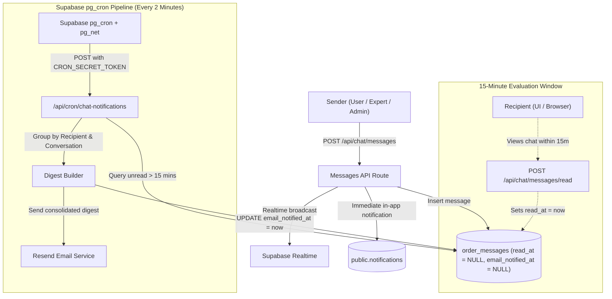

# Plan: Delayed Chat Email Notifications (15-Minute Grace Window & Unread Digest)

> **Status:** 🟢 **COMPLETED**  
> **Created:** 2026-11-23 12:02:59  
> **Last Updated:** 2026-11-23  
> **Target Source Files:** `supabase/migrations/`, `src/types/database.types.ts`, `src/app/api/emails/chatNotification.ts`, `src/app/api/chat/messages/route.ts`, `src/app/api/cron/chat-notifications/route.ts`, `tests/`  
> **Prerequisites:** [2026-11-21_205705_order_communication_channels.md](file:///home/victor/Projects/Speedy_Site_SaaS/docs/plans/2026-11-21_205705_order_communication_channels.md)  
> **Related ADR:** [ADR-0003: Delayed Chat Email Notifications (15-Minute Grace Window & Unread Digest)](file:///home/victor/Projects/Speedy_Site_SaaS/docs/adr/0003-delayed-chat-email-notifications.md), [ADR-0002](file:///home/victor/Projects/Speedy_Site_SaaS/docs/adr/0002-order-communication-channels.md)  
> **Related System Dossier:** [docs/systems/order-communication-channels.md](file:///home/victor/Projects/Speedy_Site_SaaS/docs/systems/order-communication-channels.md)  

---

## 📋 Phase Objectives & Progress Checklist

- [x] **Phase 1: Database Migration, Schema Indexing & pg_cron Setup**
  - [x] Migration adding `email_notified_at timestamptz` column to `public.order_messages`.
  - [x] Partial/composite index `idx_order_messages_unnotified_unread` on `(read_at, email_notified_at, created_at)` for high-performance cron scans.
  - [x] Supabase `pg_cron` schedule registration invoking the digest processor via `pg_net` or database worker.
  - [x] Regenerate TypeScript definitions (`make types`).
- [x] **Phase 2: Immediate vs Delayed Notification Separation**
  - [x] Decouple in-app notifications from external email alerts in `src/app/api/chat/messages/route.ts`.
  - [x] Keep in-app bell notifications (`public.notifications`) immediate upon message creation.
  - [x] Remove immediate Resend email dispatch from the real-time message submission path.
- [x] **Phase 3: Unread Digest Batching & Email Dispatcher**
  - [x] Refactor `src/app/api/emails/chatNotification.ts` into a digest-capable sender that handles batched unread messages per recipient.
  - [x] Build responsive HTML email template for single and multi-message digests with site context and deep-links.
  - [x] Implement atomic update setting `email_notified_at = now()` for all dispatched message IDs to prevent double delivery.
- [x] **Phase 4: Cron Evaluation Route & Security Authorization**
  - [x] Implement secure route `POST /api/cron/chat-notifications` gated by `CRON_SECRET_TOKEN` or `ADMIN_WEBHOOK_SECRET`.
  - [x] Wire `pg_cron` + `pg_net` to call `POST /api/cron/chat-notifications` on a recurring interval (e.g. every 2 minutes).
  - [x] Query unread candidate messages: `read_at IS NULL AND email_notified_at IS NULL AND created_at <= now() - interval '15 minutes'`.
  - [x] Group messages by recipient and conversation/order, resolve recipient addresses from `profiles`, and trigger digest dispatch.
- [x] **Phase 5: Automated Test Suite & Quality Verification**
  - [x] Unit test: verify message read within 15 minutes is excluded from email dispatch.
  - [x] Unit test: verify message unread after 15 minutes triggers digest and marks `email_notified_at`.
  - [x] Unit test: verify multiple unread messages from same conversation consolidate into one email.
  - [x] Unit test: verify cron endpoint rejects unauthorized calls.
  - [x] Run `make check` and verify zero em-dashes across all modified files.

---

## 1. Overview & Problem Statement

Currently, sending an order chat message immediately dispatches both an in-app notification row (`public.notifications`) and an external email via Resend (`src/app/api/emails/chatNotification.ts`).

### The Problem
During active back-and-forth communication between a customer and their assigned performance expert (or between an admin and expert on the internal channel), participants are already looking at their screens. Immediate emails flood recipient inboxes with dozens of redundant emails for messages they have already read in the browser.

### The Solution: 15-Minute Grace Window with Supabase `pg_cron`
1. **Immediate In-App Alerts**: In-app notifications in `public.notifications` and Supabase Realtime events remain instantaneous. Online users see messages immediately.
2. **15-Minute Read Evaluation**: When a message is sent, no email is sent immediately. The system waits 15 minutes.
3. **Suppression on Read**: When the recipient views the conversation in the UI, `POST /api/chat/messages/read` stamps `read_at = now()`. When the 15-minute evaluation occurs, any message with `read_at IS NOT NULL` is discarded from email sending (zero emails sent).
4. **Consolidated Digest on Unread**: If messages remain unread after 15 minutes (`read_at IS NULL` and `email_notified_at IS NULL`), a single digest email is compiled per recipient per conversation. All included message IDs are stamped with `email_notified_at = now()`.
5. **Scheduler Choice (pg_cron)**: Supabase native `pg_cron` (with `pg_net`) is the selected scheduler. Cloudflare Worker Cron is deprecated and being phased out, and Vercel Cron is restricted on Hobby tier plans.

---

## 2. Component Architecture & Data Flow



---

## 3. Database Schema Modifications

### Migration: `order_messages_email_notified_at` & `pg_cron` Registration
```sql
-- Migration: Add email_notified_at and unread index for delayed chat notifications
ALTER TABLE public.order_messages
ADD COLUMN IF NOT EXISTS email_notified_at timestamptz NULL;

-- High-performance partial index for pending unread notifications
CREATE INDEX IF NOT EXISTS idx_order_messages_unnotified_unread
ON public.order_messages (conversation_id, created_at)
WHERE read_at IS NULL AND email_notified_at IS NULL;

-- Enable pg_cron and pg_net extensions if not already present
CREATE EXTENSION IF NOT EXISTS pg_cron;
CREATE EXTENSION IF NOT EXISTS pg_net;

-- Register recurring scheduled job (every 2 minutes)
-- Invokes internal cron endpoint with bearer authentication
SELECT cron.schedule(
    'process-unread-chat-notifications',
    '*/2 * * * *',
    $$
    SELECT net.http_post(
        url := current_setting('app.settings.service_url', true) || '/api/cron/chat-notifications',
        headers := jsonb_build_object(
            'Content-Type', 'application/json',
            'Authorization', 'Bearer ' || current_setting('app.settings.cron_secret', true)
        ),
        body := '{}'::jsonb
    );
    $$
);
```

---

## 4. Query & Batching Algorithm

### Step 1: Candidate Selection
Fetch messages satisfying the 15-minute grace threshold:
```sql
SELECT 
    m.id,
    m.conversation_id,
    m.sender_id,
    m.body,
    m.created_at,
    c.order_id,
    c.channel_type,
    o.website_name,
    o.user_id AS order_owner_id,
    p_sender.email AS sender_email,
    p_sender.role AS sender_role
FROM public.order_messages m
JOIN public.order_conversations c ON c.id = m.conversation_id
JOIN public.orders o ON o.order_id = c.order_id
JOIN public.profiles p_sender ON p_sender.id = m.sender_id
WHERE m.read_at IS NULL
  AND m.email_notified_at IS NULL
  AND m.created_at <= (now() - interval '15 minutes')
ORDER BY m.created_at ASC;
```

### Step 2: Target Recipient Resolution
- **Client Channel (`channel_type = 'client'`)**:
  - If sender is customer (`user_id = order_owner_id`): recipient is the active assigned expert from `order_assignments` where `is_active = true`.
  - If sender is expert: recipient is the order owner (`orders.user_id`).
- **Internal Channel (`channel_type = 'internal'`)**:
  - If sender is expert: recipients are platform admins (`profiles.role = 'admin'`).
  - If sender is admin: recipient is the active assigned expert.

### Step 3: Consolidation & Dispatch
1. Group unread messages by recipient email and order.
2. Build email digest:
   - Subject: `[Speedy Site] Unread message(s) for {website_name} [{CHANNEL}]`
   - Content: Number of unread messages, timestamps, truncated previews, and direct CTA to `/dashboard/managed-wp/status` or `/dashboard/expert/orders`.
3. Dispatch email via Resend.
4. Mark all included message IDs with `email_notified_at = now()`.

---

## 5. Security & Verification Gates

### Security & Access Control
- The cron route `/api/cron/chat-notifications` must validate headers:
  - `Authorization: Bearer <CRON_SECRET_TOKEN>` or `x-webhook-secret: <CRON_SECRET_TOKEN | ADMIN_WEBHOOK_SECRET>`.
  - Disallow any unauthenticated public invocation.

### Automated Test Cases (`tests/delayed-chat-notifications.test.mjs`)
1. **Suppression Gate**: Messages marked with `read_at` within 15 minutes are never dispatched by the cron.
2. **Threshold Gate**: Messages created 14 minutes ago are ignored; messages created 16 minutes ago are processed.
3. **Consolidation Gate**: 3 unread messages for the same order create exactly 1 outbound email with 3 message summaries.
4. **Idempotency Gate**: Re-running the cron immediately after dispatch produces 0 additional emails.
5. **Code Style Invariant**: Ensure zero em-dashes across all touched source files and documentation.
