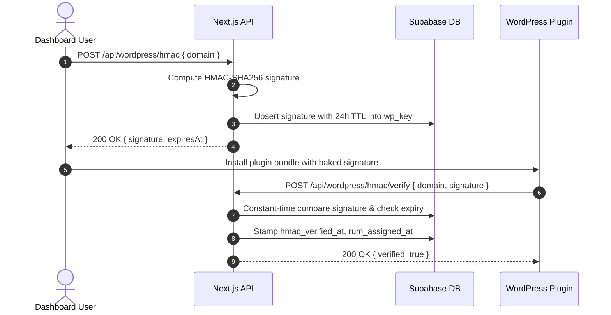

# Protocol Specification: WordPress Plugin HMAC Handshake

> **Transport:** HTTPS JSON POST  
> **Endpoints:** `/api/wordpress/hmac`, `/api/wordpress/hmac/verify`, `/api/wordpress/injection`  
> **Status:** Active / Production  

---

## 1. Handshake Flow & Wire Sequence

The plugin onboarding and verification sequence ensures mutual domain ownership without manual secret exchange:



---

## 2. Signature Generation & Verification Framing

### Signature Generation Specification
- **Algorithm:** HMAC-SHA256
- **Secret Key:** `WP_HMAC_SECRET` (server-side environment variable)
- **Message Format:** `${normalizedDomain}:${timestamp}:${nonce}`
- **TTL Window:** 24 hours (86,400,000 ms)

### Request / Response Schemas

#### Step 1: Prepare Signature
- **Endpoint:** `POST /api/wordpress/hmac`
- **Request Body:**
  ```json
  {
    "domain": "example.com"
  }
  ```
- **Response (200 OK):**
  ```json
  {
    "signature": "a7b8c9d0...",
    "expiresAt": "2026-11-22T14:12:00.000Z"
  }
  ```

#### Step 2: Verification Handshake
- **Endpoint:** `POST /api/wordpress/hmac/verify`
- **Request Body:**
  ```json
  {
    "domain": "example.com",
    "signature": "a7b8c9d0..."
  }
  ```
- **Response (200 OK):**
  ```json
  {
    "verified": true
  }
  ```
- **Response (400 Bad Request):**
  ```json
  {
    "error": "Invalid or expired signature"
  }
  ```

---

## 3. Dynamic RUM Injection Decision Protocol

- **Endpoint:** `POST /api/wordpress/injection`
- **Request Body:**
  ```json
  {
    "domain": "example.com"
  }
  ```
- **Response when entitled (200 OK):**
  ```json
  {
    "inject": true,
    "scriptUrl": "https://rum.speedy.site/rum.js"
  }
  ```
- **Response when not entitled or free (200 OK):**
  ```json
  {
    "inject": false
  }
  ```
