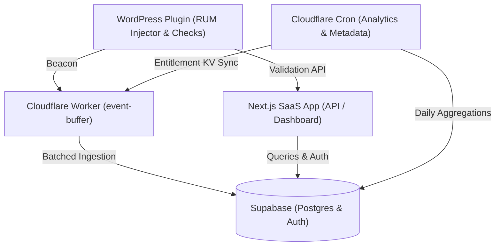

# Speedy Site SaaS Subsystems Documentation

Welcome to the macro systems architecture documentation for **Speedy Site SaaS**.

---

## 🗺️ Subsystem Architecture Map

The system is organized into decoupled layers: WordPress companion plugin, edge ingestion / analytics workers, Supabase persistence/auth, and the Next.js SaaS dashboard:

---

## 📁 Subsystem Dossiers

| Subsystem Dossier | Description & Scope |
| :--- | :--- |
| [user-onboarding-flow.md](file:///home/victor/Projects/Speedy_Site_SaaS/docs/systems/user-onboarding-flow.md) | The signed-in funnel from free site registration to CrUX/PSI checks and onboarding tour |
| [onboarding-assignment.md](file:///home/victor/Projects/Speedy_Site_SaaS/docs/systems/onboarding-assignment.md) | Webhook-driven onboarding notification and expert assignment system |
| [admin-expert-management.md](file:///home/victor/Projects/Speedy_Site_SaaS/docs/systems/admin-expert-management.md) | Admin console, expert invitation, capacity management, and order triaging |
| [managed-wp-order-assignment.md](file:///home/victor/Projects/Speedy_Site_SaaS/docs/systems/managed-wp-order-assignment.md) | Round-robin Managed WordPress order dispatch and expert pool allocation |
| [rum-injector-plugin.md](file:///home/victor/Projects/Speedy_Site_SaaS/docs/systems/rum-injector-plugin.md) | WordPress plugin architecture for automated RUM collector script injection |
| [site-metadata-worker.md](file:///home/victor/Projects/Speedy_Site_SaaS/docs/systems/site-metadata-worker.md) | Cloudflare KV edge entitlement synchronization for RUM data ingestion |
| [analytics-pipeline.md](file:///home/victor/Projects/Speedy_Site_SaaS/docs/systems/analytics-pipeline.md) | Analytics cron workers, aggregation pipeline, and edge read-path optimization |
