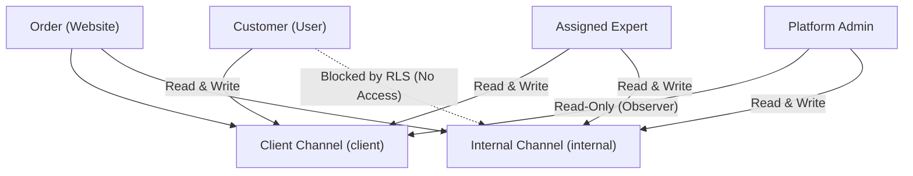

# Order Communication Channels & Role-Gated Collaboration

> **Status:** Implemented v1  
> **Owner:** Core Engineering Team  
> **Last Updated:** 2026-11-23  
> **Related ADR:** [ADR-0002: Order-Scoped Communication Channels with Role-Gated Access](file:///home/victor/Projects/Speedy_Site_SaaS/docs/adr/0002-order-communication-channels.md)  
> **Related Plan:** [2026-11-21_205705_order_communication_channels.md](file:///home/victor/Projects/Speedy_Site_SaaS/docs/plans/2026-11-21_205705_order_communication_channels.md)  

---

## 1. Overview & Architectural Goals

The Order Communication subsystem establishes real-time, order-scoped communication channels between customers and assigned WordPress performance experts, with strict administrative oversight:
1. **Order Scoping**: Every conversation is permanently bound to a verified optimization order (`order_id`) and its associated website.
2. **Dual-Channel Architecture**:
   - **Client Channel (`client`)**: Open to the customer and the active assigned expert. Platform administrators have database-enforced read-only inspection for compliance and quality control; administrators cannot post to customer threads.
   - **Internal Channel (`internal`)**: Dedicated staff communication between administrators and the assigned expert regarding order strategy, blockers, or credentials. Completely hidden from the customer.
3. **Realtime & Offline Delivery**: Live messaging powered by Supabase Realtime subscriptions and broadcast channels, backed by in-app notifications (`public.notifications`) and email alerts via Resend for offline recipients.

---

## 2. Component Architecture & Data Flow



### Access & Permission Matrix

| Role | Client Channel (`client`) | Internal Channel (`internal`) | UI Presentation |
| :--- | :--- | :--- | :--- |
| **Customer (`user`)** | Read + Write | No Access (invisible in queries and subscriptions) | Embedded card in `/dashboard/managed-wp/status` |
| **Assigned Expert (`expert`)** | Read + Write | Read + Write | Two-tab communications drawer in `/dashboard/expert/orders` |
| **Admin (`admin`)** | Read-Only (writes rejected by RLS) | Read + Write | Dual-pane drawer in `/dashboard/admin/orders` |

---

## 3. Data Model & Row Level Security

The subsystem is implemented via two tables in Supabase Postgres:

### 3.1 `order_conversations`
Tracks the conversation threads for each order:
```sql
CREATE TABLE IF NOT EXISTS public.order_conversations (
    id              uuid PRIMARY KEY DEFAULT gen_random_uuid(),
    order_id        uuid NOT NULL REFERENCES public.orders(order_id) ON DELETE CASCADE,
    channel_type    text NOT NULL CHECK (channel_type IN ('client', 'internal')),
    created_at      timestamptz NOT NULL DEFAULT now(),
    updated_at      timestamptz NOT NULL DEFAULT now(),
    last_message_at timestamptz NOT NULL DEFAULT now(),
    CONSTRAINT uq_order_channel UNIQUE (order_id, channel_type)
);
```

### 3.2 `order_messages`
Append-only log of messages within each conversation:
```sql
CREATE TABLE IF NOT EXISTS public.order_messages (
    id              uuid PRIMARY KEY DEFAULT gen_random_uuid(),
    conversation_id uuid NOT NULL REFERENCES public.order_conversations(id) ON DELETE CASCADE,
    sender_id       uuid NOT NULL REFERENCES auth.users(id) ON DELETE CASCADE,
    body            text NOT NULL CHECK (char_length(trim(body)) > 0 AND char_length(body) <= 5000),
    is_system       boolean NOT NULL DEFAULT false,
    created_at      timestamptz NOT NULL DEFAULT now(),
    read_at         timestamptz
);
```

### 3.3 Security Invariants
- **Database-Level Enforcement**: Row Level Security (RLS) policies validate all operations. Even if an admin user attempts an `INSERT` on a `client` channel row, Postgres throws an RLS authorization error.
- **SECURITY DEFINER Helpers**: Functions `is_order_owner(p_order_id)` and `is_active_order_expert(p_order_id)` prevent recursive RLS evaluation during query execution.
- **Automated Provisioning**: Triggers on `orders` and `order_assignments` automatically provision both `client` and `internal` conversations upon record creation.

---

## 4. Realtime Pub/Sub & Notification Pipeline

1. **Supabase Realtime**:
   - `order_messages` is published to `supabase_realtime`.
   - Client hook `useRealtimeChat` in `src/lib/chat/realtime.ts` listens for `INSERT` and `UPDATE` (read receipt) events scoped to `conversation_id`.
   - Realtime broadcast channel `order-convo:${conversationId}` broadcasts transient typing indicator states.
2. **Notification Dispatch**:
   - Server handler `dispatchChatNotification` in `src/app/api/emails/chatNotification.ts` executes on new messages.
   - Generates in-app notification rows in `public.notifications`.
   - Dispatches email alerts with message previews via Resend to counterparty inboxes when offline.

---

## 5. UI Integration & Portal Touchpoints

| Portal | URL | Feature & Linkage |
| :--- | :--- | :--- |
| **Customer** | `/dashboard/managed-wp/status` | Direct expert chat panel, sidebar link under Managed WP, top-bar chat button |
| **Expert** | `/dashboard/expert/orders` | "Open Chat" action in orders table, two-tab drawer (Customer vs Admin Backchannel), RUM deep-link |
| **Admin** | `/dashboard/admin/orders` | Order detail drawer with read-only customer dialogue stream and active expert backchannel |
| **Global** | Top bar `Inset-Header` | Notification dropdown with direct navigation to unread message links (`router.push`) |
| **Support** | `/account/tickets` | Disambiguation banner directing managed optimization clients to expert chat |

---

## 6. Verification & Automated Tests

Automated regression coverage is maintained in `tests/order-communication-channels.test.mjs`, verifying:
- Customer access to client channel and 403 rejection from internal channel.
- Admin read-only inspection on client channel and 403 rejection on write attempts.
- Expert full participation in both client and internal channels.
- Unassigned expert rejection from unauthorized order threads.
- Read receipt updates on message consumption.
